## KasKu JSP Project Report

A personal finance website built with Jakarta Server Pages

| Project Details | Information |
| --- | --- |
| Member 1 | Muhammad Elmiro Rayhan - NRP 5025231296 |
| Member 2 | Ahmad Faiz Tajuddin - NRP 5025231291 |
| Project type | Group project (2 members) |
| Work distribution | Muhammad Elmiro Rayhan 75%; Ahmad Faiz Tajuddin 25% |
| Original repository | https://github.com/truewxrld/kasku |
| Report updated | 25 November 2026 |

KasKu has eight CRUD modules to help users record their personal finances. It uses JSP for the pages, Servlets to handle requests, and JDBC to save data. This report explains the database design, features, website pages, group tasks, and test results.

The website running with demo data. The screenshot was taken on 18 November 2026.

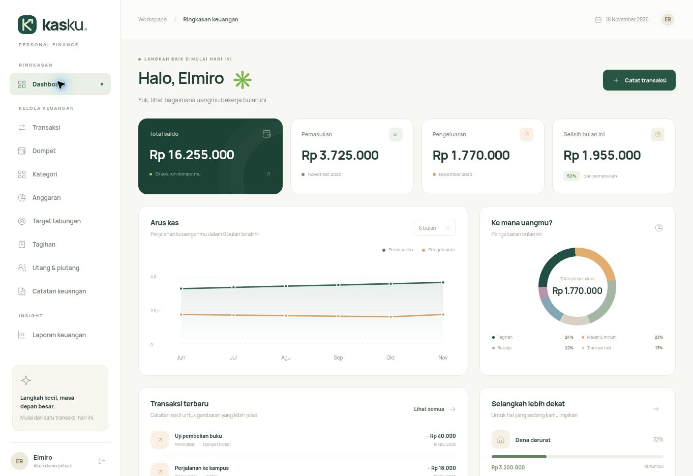

**Project status:** The code and report are ready. The project owner will upload the code to GitHub and publish the website. The website has not been published yet. The screenshots show the original Indonesian interface.

## Project Overview and Features

KasKu continues the idea from the original Laravel/PHP repository. The new version uses Java/Jakarta JSP to meet the assignment requirements. It runs on its own and does not need the Laravel app. Data from the old app is not moved automatically.

| No. | CRUD Module | Create | Read | Update | Delete |
| --- | --- | --- | --- | --- | --- |
| 1 | Wallets | Yes | Yes | Yes | Yes |
| 2 | Categories | Yes | Yes | Yes | Yes |
| 3 | Transactions | Yes | Yes | Yes | Yes |
| 4 | Budgets | Yes | Yes | Yes | Yes |
| 5 | Savings goals | Yes | Yes | Yes | Yes |
| 6 | Bills | Yes | Yes | Yes | Yes |
| 7 | Debts and money owed | Yes | Yes | Yes | Yes |
| 8 | Finance notes | Yes | Yes | Yes | Yes |

Each module has four actions: Create, Read, Update, and Delete. This gives 32 main CRUD actions. Read includes a list page and a detail page. Login, the dashboard, search, reports, and export are extra features. They are not part of the eight-module count.

### Tools and Technologies

| Part | Tools |
| --- | --- |
| Pages | JSP 3.1, JSTL, responsive CSS, JavaScript, SVG |
| Application | Java target 17, Jakarta Servlet 6, Tomcat 10.1 |
| Database | JDBC; an H2 file for local use; PostgreSQL for hosting |
| Build and tests | Maven, JUnit 5, HTTP tests with Python 3 |
| Project files | Source code, SQL, WAR, Dockerfile, Render settings |

## Conceptual Data Model

The CDM shows nine entities and their relationships.

KasKu CDM. One user can have zero or many records in each module.

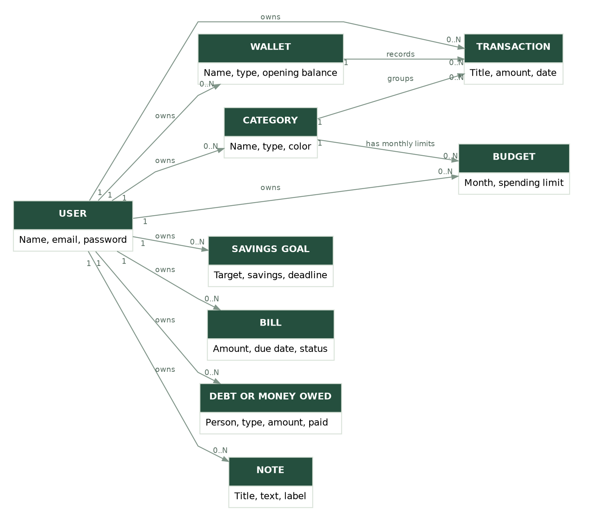

Each transaction belongs to one wallet and one category. Each budget uses one expense category. A category can have many budgets for different months. Savings goals, bills, debts, and notes belong directly to a user.

The number 1 means one parent record. The label 0..N means zero or many related records. Users do not share their financial data with other accounts.

## Physical Data Model: Main Tables

The first PDM shows users, wallets, categories, transactions, and budgets.

PK = primary key; FK = foreign key; UQ = unique constraint. Every module table requires a user_id.

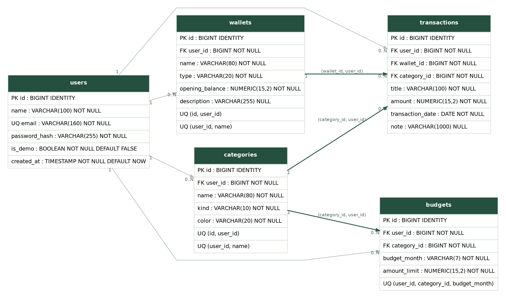

The foreign keys in transactions and budgets use an ID together with user_id. This stops users from choosing a wallet or category that belongs to another account, even if they know its ID. The full SQL is in database/schema.sql.

## Physical Data Model: Other Tables

The second PDM shows four more tables. The users table is the same table as in the first PDM.

All IDs use BIGINT identity. Money values use NUMERIC(15,2).

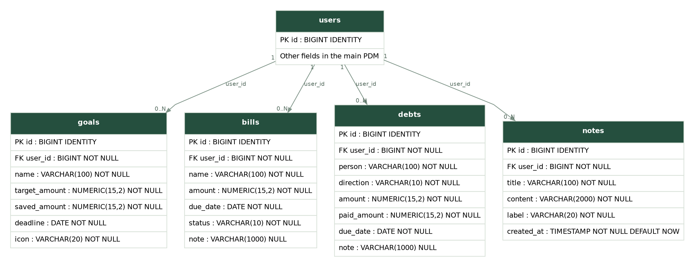

The goals table stores savings targets and progress. The bills table stores bills. The debts table stores money owed by or to a user. The notes table stores notes. All user_id fields refer to users.id with ON DELETE CASCADE. The app does not provide an account deletion feature.

## Database Rules and Calculations

| Part | Main Rule |
| --- | --- |
| IDs and names | IDs are created automatically. Each email must be unique. Wallet and category names must be unique within one account. |
| Relationships | A transaction must use a wallet and category from the same account. A budget must use a category from its own account. |
| Budgets | UNIQUE(user_id, category_id, budget_month). The app checks the YYYY-MM month format and requires an expense category. |
| Money values | Opening balance, saved amount, and paid amount cannot be negative. Transaction, bill, savings target, and budget amounts must be greater than zero. |
| Progress | saved_amount cannot be higher than target_amount. paid_amount cannot be higher than amount. |
| Delete rules | A wallet or category that is still in use cannot be deleted. Related records are not removed without notice. |
| Category type | The income/expense type cannot be changed if a transaction or budget already uses the category. |
| Indexes | Indexes on owners, transaction dates, wallets, categories, and due dates help the app find records faster. |

### Formulas Used in the App

**Wallet balance** = opening balance + total income - total expenses.
**Budget used** = expenses in the selected category and month.
**Remaining debt or money owed** = original amount - paid amount.
**Savings progress** = saved amount / target amount x 100%.

Money calculations use BigDecimal. Charts use totals from transaction records. Users update savings progress and bill or debt payments manually. To change a wallet balance, users must also add a transaction. The app does not connect to bank accounts or make payments.

## Group Tasks and App Structure

| Member | Student ID (NRP) | Contribution |
| --- | --- | --- |
| Muhammad Elmiro Rayhan | 5025231296 | 75% |
| Ahmad Faiz Tajuddin | 5025231291 | 25% |

This is a group project with two members. Muhammad Elmiro Rayhan is responsible for 75% of the work, and Ahmad Faiz Tajuddin is responsible for 25%. The total contribution is 100%.

| Member | Tasks and Contributions |
| --- | --- |
| Muhammad Elmiro Rayhan (75%) | Plans the features and page flow. Designs the CDM, PDM, and SQL schema. Develops the Java and JSP code, login system, eight CRUD modules, and finance calculations. Connects the parts of the app. |
| Ahmad Faiz Tajuddin (25%) | Works on the page layout and display on different screen sizes. Helps test the features and record issues. Prepares screenshots, feature descriptions, and the project report. |

AI support: AI helped with the code and the first draft of the report. The percentages show the students' responsibilities in the group. Both members should understand, review, and test the work before submission.

### Main Code Parts

AppServlet handles requests and chooses the JSP page. Records checks input and runs CRUD actions using a fixed list of tables and columns. Database opens JDBC connections and sets up the schema. Finance calculates balances and totals. SecurityFilter checks the session and CSRF token. Passwords stores passwords as salted hashes. JSP pages inside WEB-INF/views can only be opened through the controller.

## Accounts and Demo Data

Users sign up with a name, email, and password of at least eight characters. After login, they only see their own data. The logout button ends the session. The demo button opens a new demo account with sample data. Each demo session has separate data.

The login page. The demo button lets a visitor try the app without using a personal account.

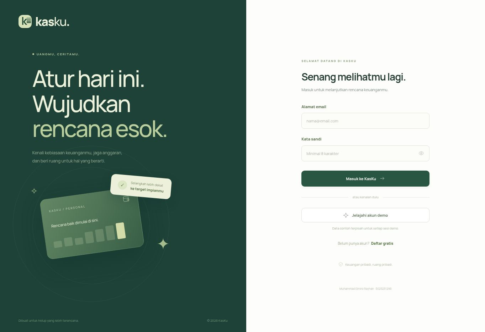

### How to Start

For a new account, sign up, add a wallet, add a category, and record a transaction. Then add budgets, savings goals, bills, debts, and notes as needed. A normal account starts empty. A demo account contains sample records.

Passwords use PBKDF2-HMAC-SHA256 with a random salt and 210,000 rounds. POST requests need a CSRF token. The session ID changes after login. JSTL escaping makes sure user text is shown as text instead of being run as HTML.

## Finance Dashboard

The dashboard shows total balance, income, expenses, and the difference for the current month. A chart compares income and expenses over six months. Other sections show expense categories, recent transactions, savings progress, budget use, and unpaid bills.

The dashboard uses totals from saved records. The values in this screenshot are demo data.

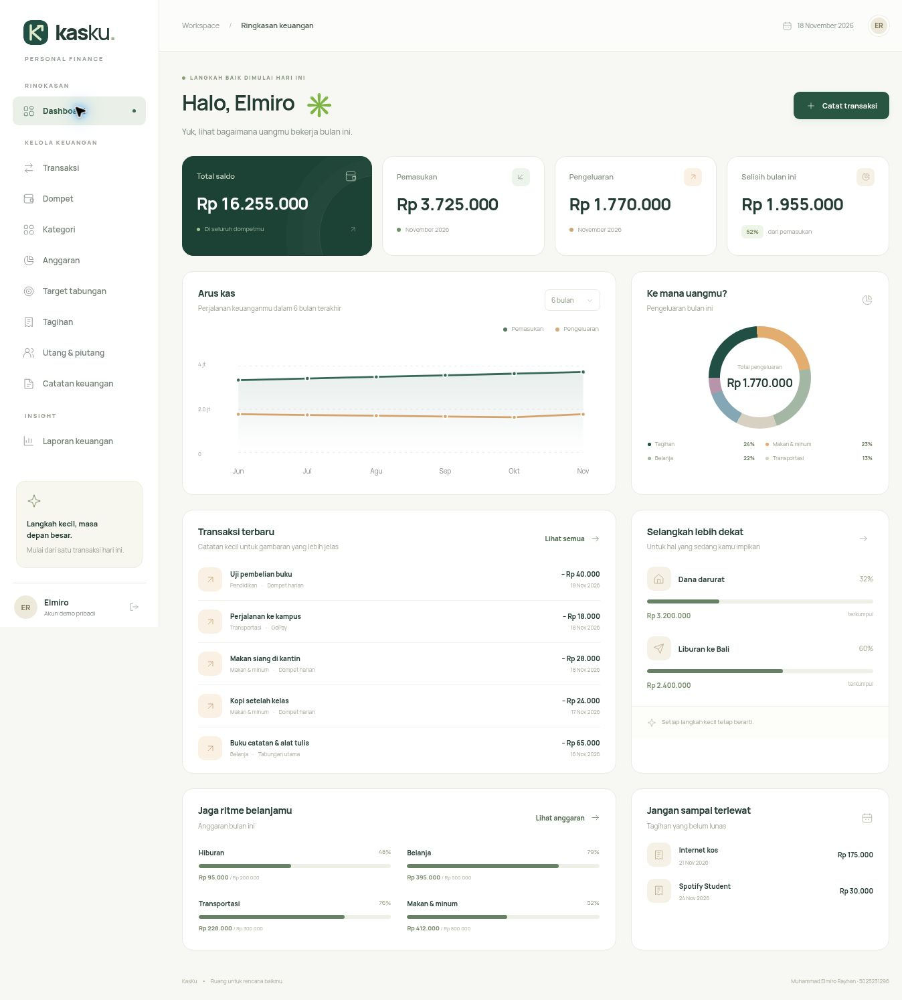

The total balance includes all recorded transactions. Monthly income and expense totals use the current month. The difference percentage is shown as zero when there is no income.

## CRUD: Wallets

Table: wallets  |  Four actions are available for the user's own data

Wallets separate bank accounts, cash, and e-wallets. Each wallet has a name, type, opening balance, and description. Its current balance is calculated from its transactions.

Wallets page with data from a demo account.

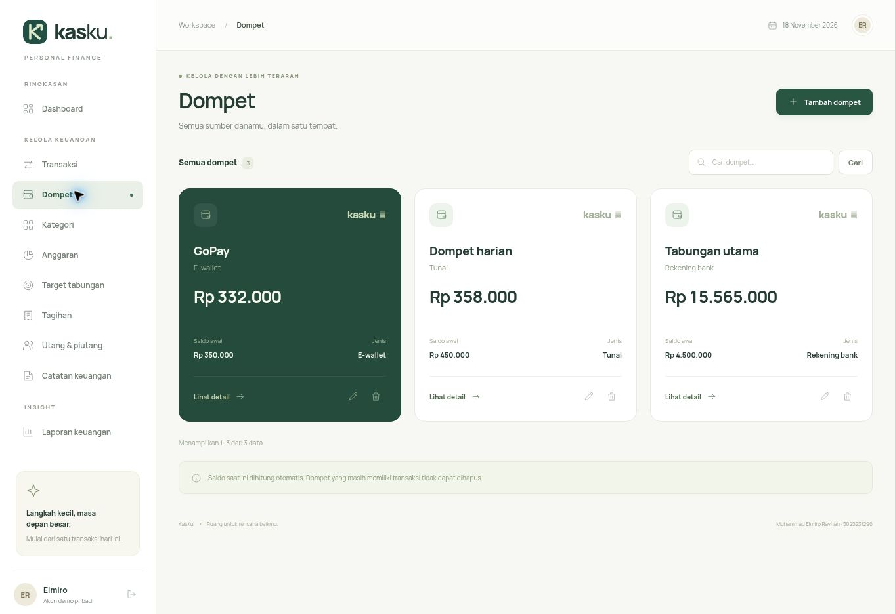

| Action | How It Works |
| --- | --- |
| Create | Enter the wallet name, type, opening balance, and description in the Add wallet form. |
| Read | View the balance cards and open a detail page to see the wallet information. |
| Update | Edit the name, type, opening balance, or description. The balance is calculated again. |
| Delete | Delete an unused wallet. A wallet that has transactions cannot be deleted. |

## CRUD: Categories

Table: categories  |  Four actions are available for the user's own data

Categories group income and expenses. Each category has a color. Examples include allowance, freelance work, food and drinks, transport, and education.

Categories page with data from a demo account.

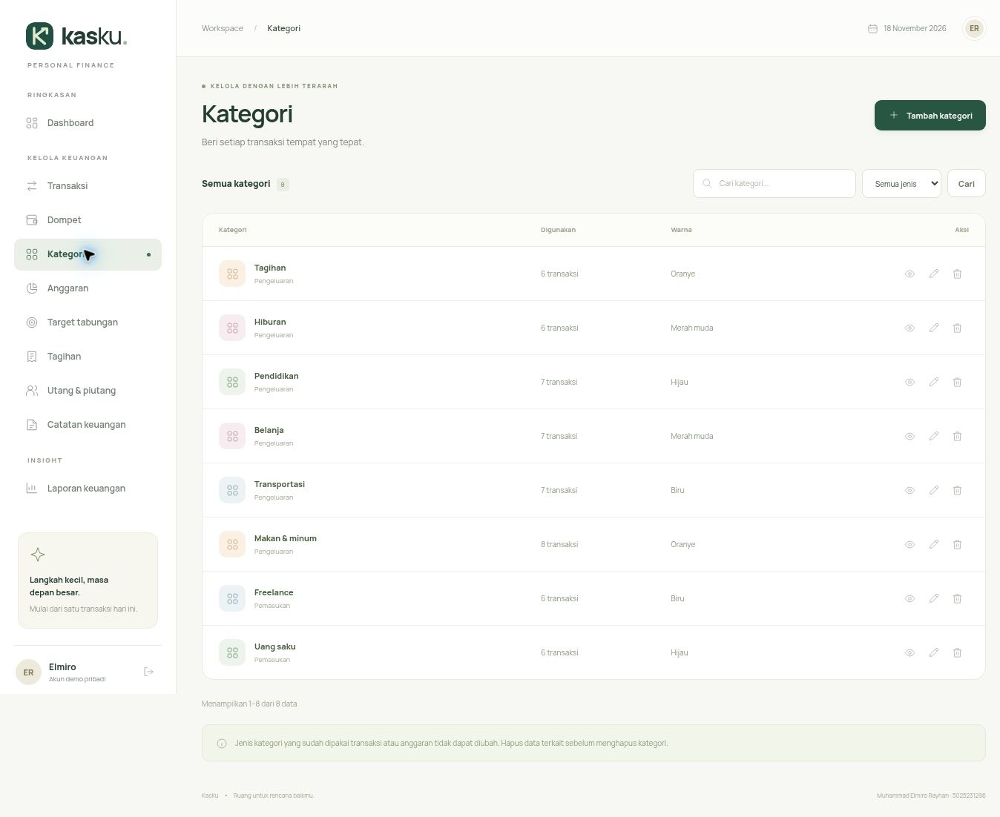

| Action | How It Works |
| --- | --- |
| Create | Add a category name, choose income or expense, and select a color. |
| Read | View category names, types, colors, and the number of transactions that use them. |
| Update | Change the name or color. The type can only change if the category is not in use. |
| Delete | Delete a category only when no transaction or budget uses it. |

## CRUD: Transactions

Table: transactions  |  Four actions are available for the user's own data

A transaction stores a title, wallet, category, amount, date, and note. The category decides whether it is income or an expense. Users can search, filter by type, and move between list pages.

Transactions page with data from a demo account.

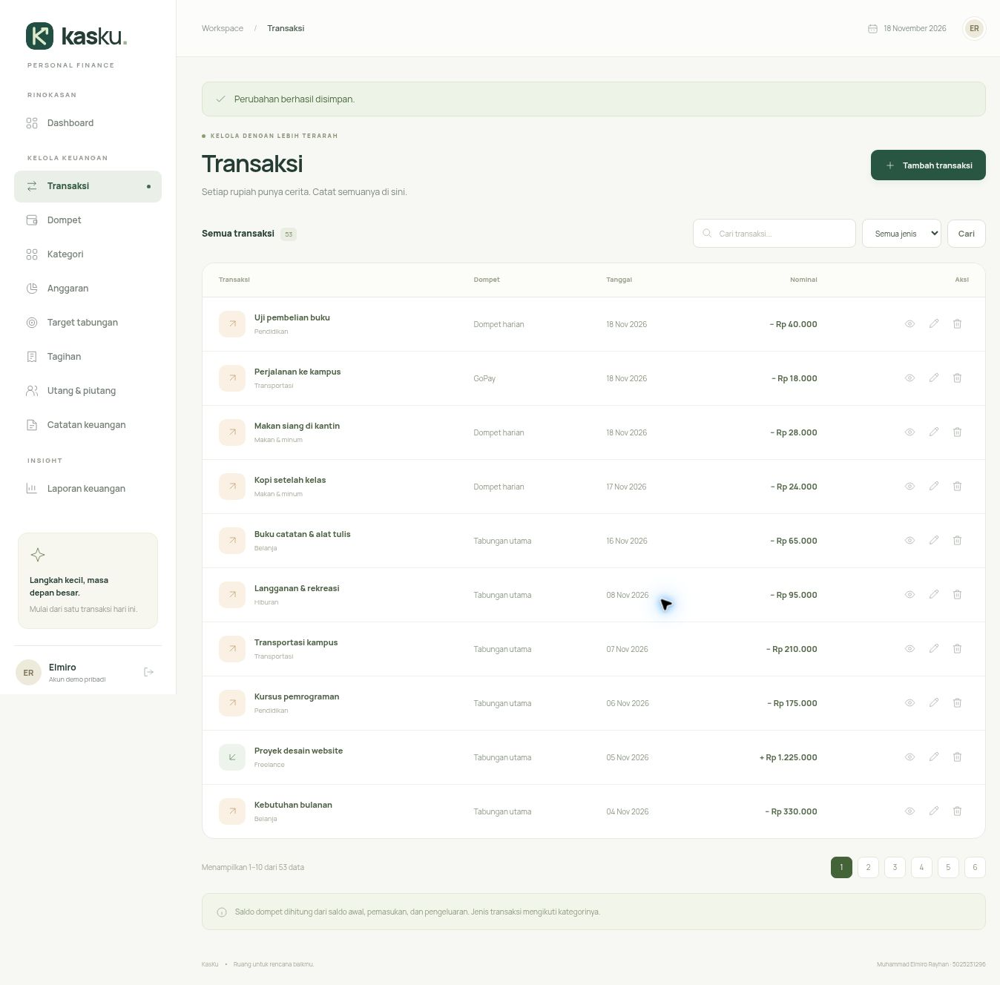

| Action | How It Works |
| --- | --- |
| Create | Choose a wallet and category from the account. Enter the amount and date. |
| Read | View the transaction list or open the detail page for more information. |
| Update | Change the transaction, such as its amount or wallet. Balances and reports also change. |
| Delete | Confirm to delete a transaction. Its effect on the balance is removed. |

## CRUD: Budgets

Table: budgets  |  Four actions are available for the user's own data

A budget sets a monthly spending limit for an expense category. The amount used comes from transactions in that category and month. Each card shows spending, the amount left, progress, and limit status.

Budgets page with data from a demo account.

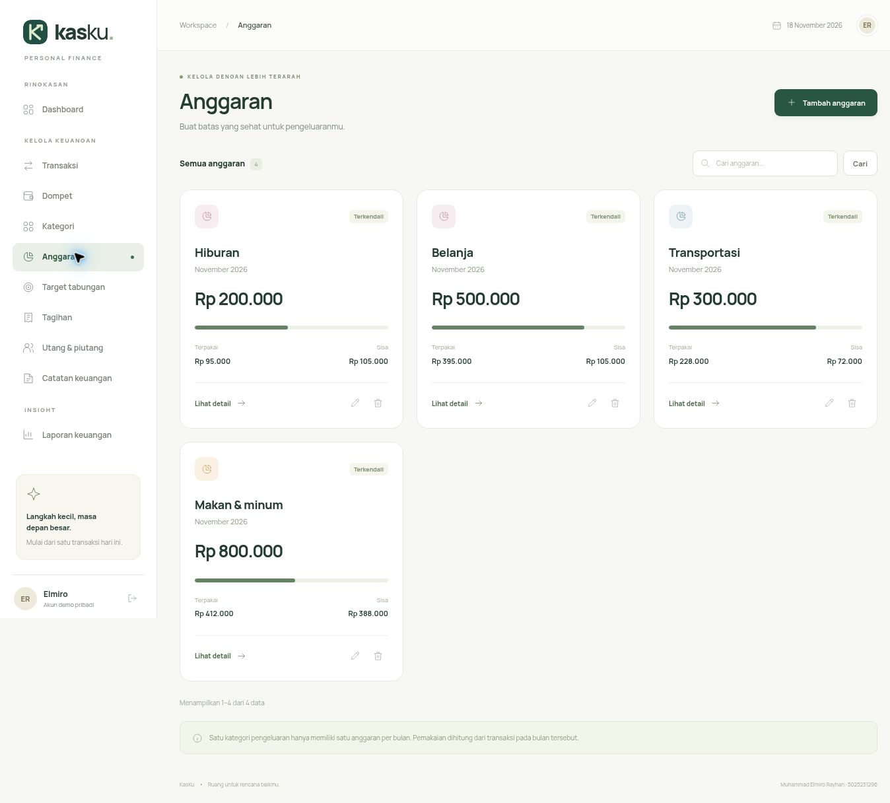

| Action | How It Works |
| --- | --- |
| Create | Choose an expense category, month, and spending limit. |
| Read | View the limit, amount used, amount left, and progress bar. |
| Update | Change the month, category, or limit. The same category and month cannot have two budgets. |
| Delete | Delete a budget plan. Existing transactions stay in the database. |

## CRUD: Savings Goals

Table: goals  |  Four actions are available for the user's own data

Savings goals help users record a target, target amount, saved amount, deadline, and icon. A percentage shows how close each goal is to completion.

Savings Goals page with data from a demo account.

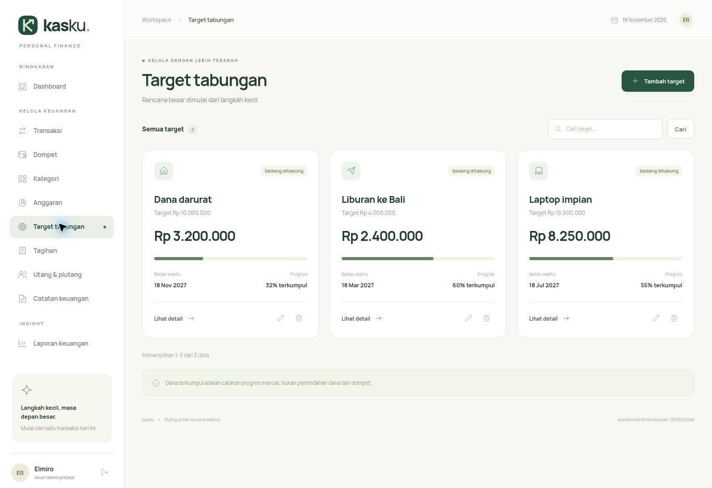

| Action | How It Works |
| --- | --- |
| Create | Enter the goal name, target amount, saved amount, deadline, and icon. |
| Read | View goal cards and open details about the amounts and deadline. |
| Update | Update the saved amount or goal details. Savings cannot be higher than the target. |
| Delete | Delete a goal that is no longer needed. Wallet balances do not change. |

## CRUD: Bills

Table: bills  |  Four actions are available for the user's own data

Bills store payments that users need to make and their due dates. A bill can be paid or unpaid. An unpaid bill past its due date is marked as late.

Bills page with data from a demo account.

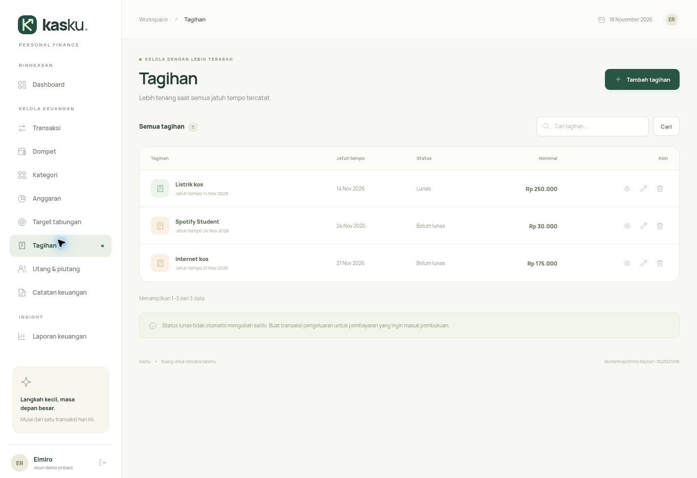

| Action | How It Works |
| --- | --- |
| Create | Add a bill name, amount, due date, status, and note. |
| Read | View the bill list, status, amounts, and detail page. |
| Update | Change the date, amount, or note, or mark the bill as paid. |
| Delete | Confirm to delete the bill record. |

## CRUD: Debts and Money Owed

Table: debts  |  Four actions are available for the user's own data

This module separates money the user owes from money other people owe to the user. Each record includes a person, type, original amount, paid amount, due date, and note.

Debts and Money Owed page with data from a demo account.

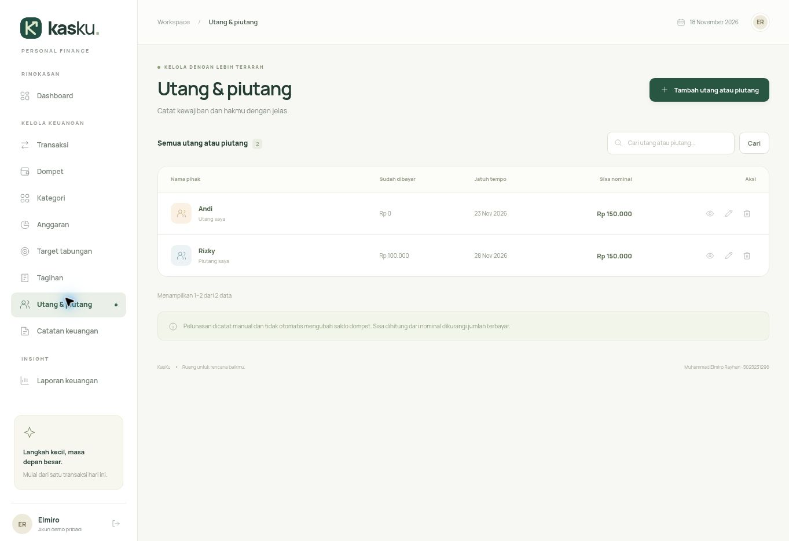

| Action | How It Works |
| --- | --- |
| Create | Enter the person, type, original amount, amount already paid, and due date. |
| Read | View the remaining amount, paid amount, and details for each person. |
| Update | Update the paid amount. It cannot be higher than the original amount. |
| Delete | Confirm to delete a record that is no longer needed. |

## CRUD: Finance Notes

Table: notes  |  Four actions are available for the user's own data

Notes store financial plans, reminders, and ideas. They do not change wallet balances. Notes can have several lines and are always shown as plain text.

Finance Notes page with data from a demo account.

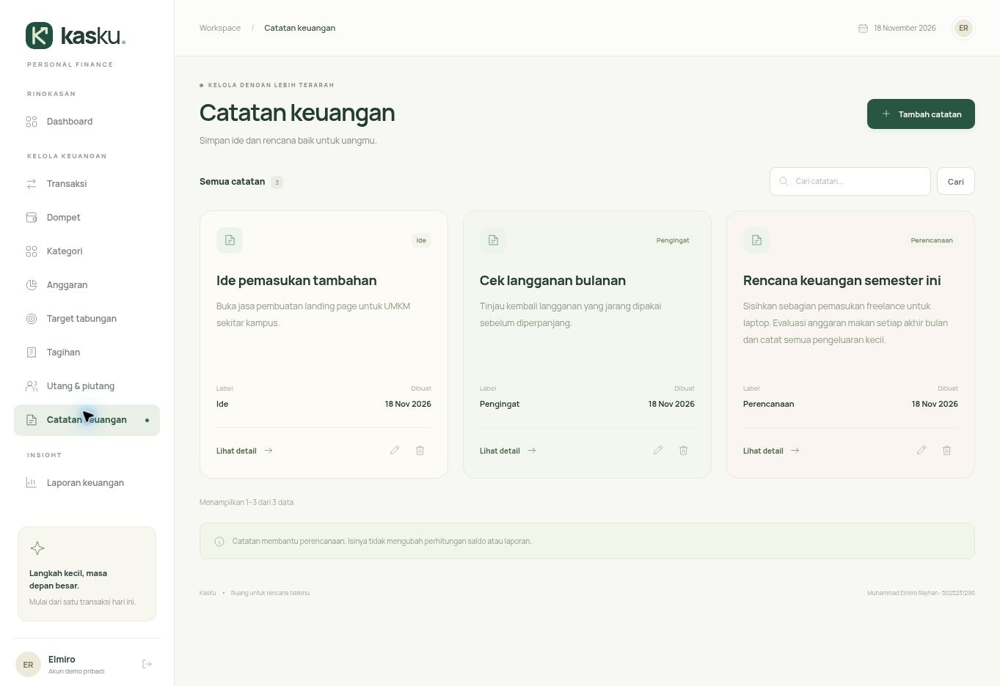

| Action | How It Works |
| --- | --- |
| Create | Enter a title, note text, and a label for a plan, reminder, or idea. |
| Read | View note cards and open a detail page to read the full note. |
| Update | Edit the title, text, or label. |
| Delete | Confirm to delete a note. |

## Forms and Detail Pages

The add and edit forms use the same JSP component. Required fields have a star. The form checks amounts and only lists wallets and categories from the current account. Error messages appear below the related fields. Entered values stay in the form when input is rejected.

The Add transaction form with wallet and category choices.

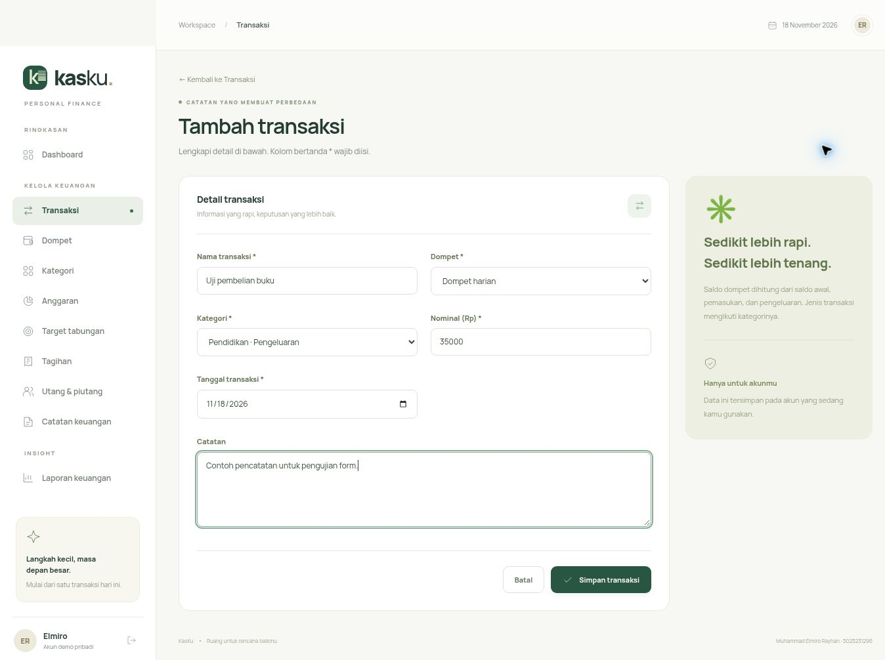

### View, Edit, and Delete

View details opens the full record. Edit data opens a form with the current values filled in. Delete opens a confirmation dialog. It shows the record name and explains what will be deleted. Cancel closes the dialog without changing data.

Extra screenshots are in docs/screenshots/14-detail-dompet.jpg and 12-konfirmasi-hapus.jpg. All changes use POST requests. After a successful change, the app redirects the user to another page.

## Reports and CSV Export

Users choose a date range to see the number of transactions, income, expenses, difference, category totals, and transaction list. The Download CSV button exports transactions from that date range.

The report page for a selected period. The full transaction list is lower on the page.

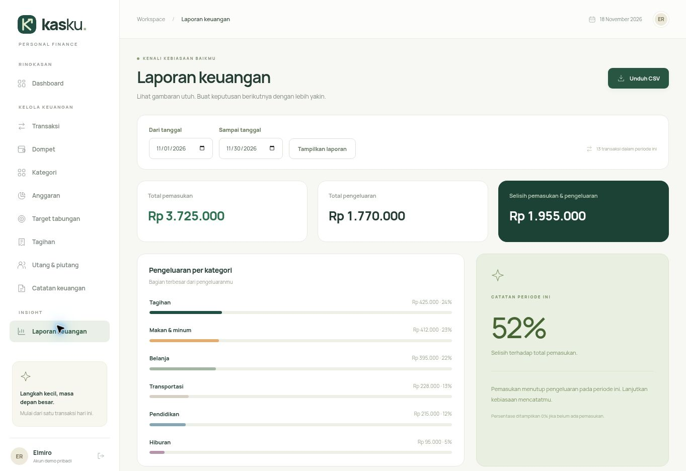

| Part | How It Works |
| --- | --- |
| Date filter | The start and end dates are included. If the date range is invalid, the app shows a message and uses the current month. |
| CSV columns | Date, title, type, category, wallet, amount, and note. |
| Safe export | Text starts with an apostrophe if a spreadsheet could treat it as a formula. Double quotes are escaped. |
| Use | Helps users review spending and move transaction data into a spreadsheet. |

## Testing and Results

The final build and tests ran again on 20 November 2026. All seven logic tests passed. One HTTP test suite also passed with 90 successful checks and no failures. The browser screenshots show the real JSP app running on 18 November 2026.

| Test | Result |
| --- | --- |
| Eight CRUD modules | Create, details, edit forms, updates, and deletion worked through HTTP requests. |
| Account access | Sign-up, login, and logout worked. Pages that need login were blocked without a session. |
| Separate user data | Users could not open another account's details or link records from different accounts. |
| Balance calculations | Balances changed correctly after transactions were edited or deleted. |
| Input checks | Negative amounts, progress above the target, invalid choices, and duplicate budgets were rejected. |
| Records in use | A wallet with transactions could not be deleted. |
| Text and CSRF | User HTML was shown as text. POST requests without a CSRF token were rejected. |
| Reports | Date filters and CSV exports returned the correct data. |
| Desktop browser | Demo login, the dashboard, all modules, add/edit forms, details, and the delete dialog were displayed. |

### What Has Not Been Tested

The app ran on JVM 21 with Java 17 bytecode and H2 in PostgreSQL mode. A live PostgreSQL server, the Docker image, public hosting, and a real phone have not been tested. CSS for small screens is included. The group should check the website again after hosting it.

Test records are in docs/unit-test-results.txt, docs/http-suite-results.txt, and docs/http-test-results.json. Run mvn test to repeat the logic tests. Run mvn -Dkasku.http=true test with Python 3 to include the HTTP tests.

## Run Locally and Prepare Hosting

### Run on a Local Computer

Install JDK 17 or 21 and Maven 3.9+. Open the project folder that contains pom.xml. Run **mvn clean package**, then **run.bat** on Windows or **sh run.sh** on Linux/macOS. Open http://localhost:8080. The app creates an H2 database file in the data folder automatically.

### GitHub and Hosting

Copy the source into the jsp-app folder in the truewxrld/kasku repository. Commit it to the final-jsp branch. For Render, use a Web Service with Docker and set the root directory to jsp-app. Use PostgreSQL in the same region. The full guide is in docs/PANDUAN_DEPLOY.md.

| Hosting Setting | Value |
| --- | --- |
| DATABASE_URL | The PostgreSQL URL from the hosting dashboard. Do not put this private URL in a public report. |
| APP_ENV | production |
| COOKIE_SECURE | true for HTTPS |
| DEMO_ENABLED | true to allow demos, or false for personal use |
| PORT | Provided by the hosting platform and read by the server automatically. |

According to the Render documentation checked on 18 November 2026, a free web service may sleep after 15 minutes without traffic, and a free PostgreSQL database expires after 30 days. Use PostgreSQL because local files on the web service are not permanent. Check the current plan and expiry date before grading. [2]

**Publishing status:** The project has not been uploaded or deployed. The project owner will do this. Add the JSP repository URL and the working website URL to the report before submission.

### References

[1] Apache Tomcat. Tomcat 10.1 Migration Guide. https://tomcat.apache.org/migration-10.1.html
[2] Render. Deploy for Free. https://render.com/docs/free
[3] Render. Monorepo Support. https://render.com/docs/monorepo-support
[4] Original KasKu repository. https://github.com/truewxrld/kasku
